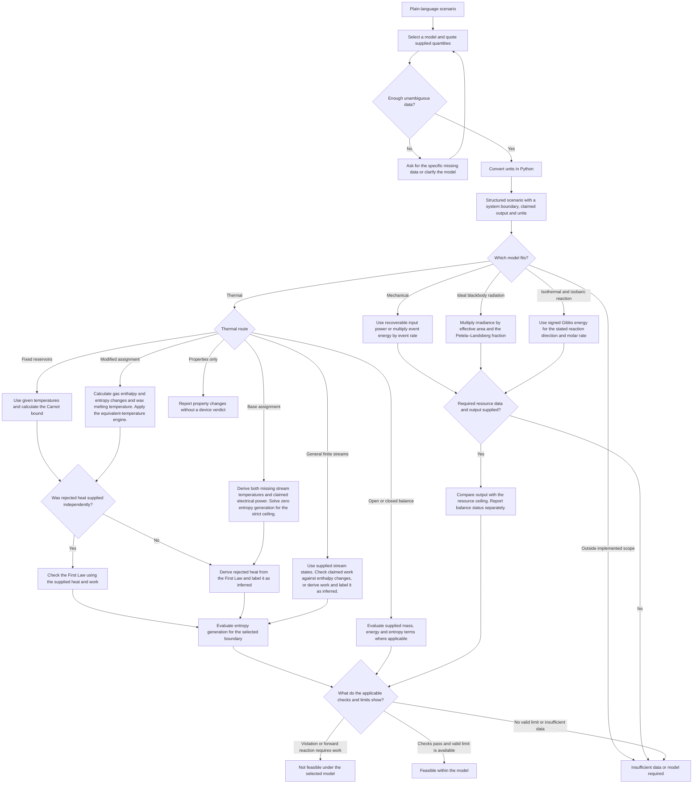

# Thermodynamic Feasibility Tester

For a general finite-stream engine, the effective-temperature comparison is optional and tied to the supplied states. The Base assignment runner also solves for the reversible cold outlet at the same hot-side duty, cold inlet and cold flow. Inferred heat or work closes the First Law by construction. A positive signed reaction Gibbs energy requires input work even for a claim of zero electrical output.
